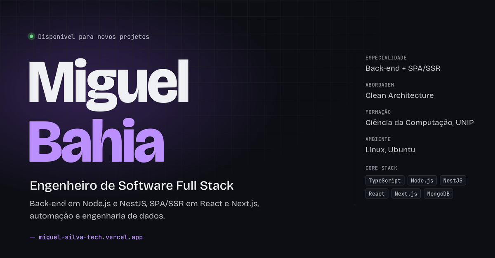
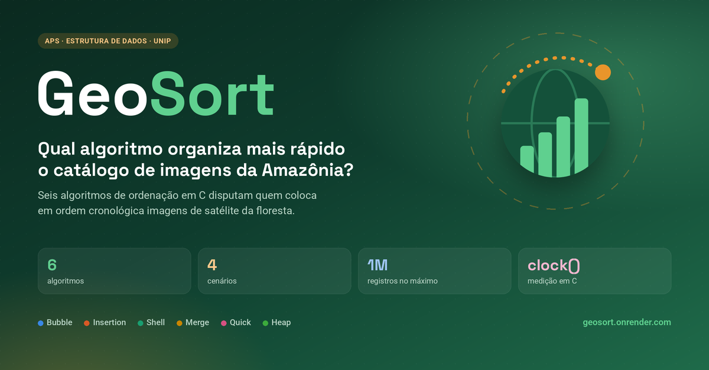
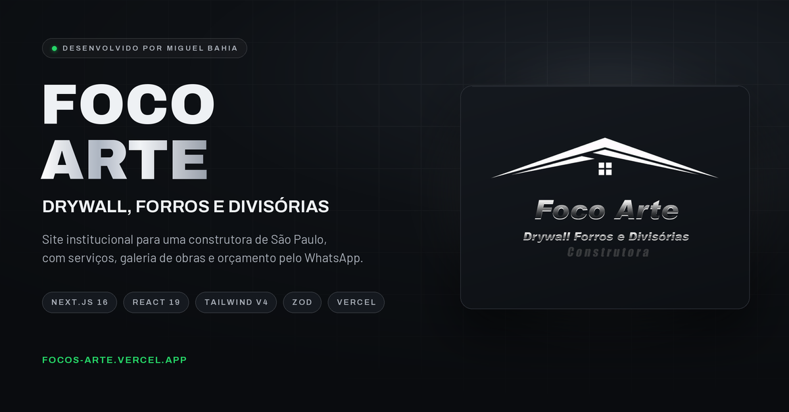

<div align="center">


<a href="https://github.com/Silver1529">
  
</a>

<p>
  <a href="https://miguel-silva-tech.vercel.app/" target="_blank">
    
  </a>
  <a href="https://www.linkedin.com/in/miguel-bahia-30094234b" target="_blank">
    
  </a>
  <a href="mailto:miguelbahia0602@gmail.com">
    
  </a>
</p>

</div>

<br>

## Sobre mim

```ts
const miguel = {
  idade: 20,
  papel: "Engenheiro de Software Full Stack",
  empresa: "Compare Plano de Saúde",
  formacao: "Ciência da Computação @ UNIP",
  foco: ["automação", "engenharia de dados", "produtos escaláveis"],
  construindo_agora: "SyncRoutine — rastreamento de tempo e performance pessoal",
  por_fora: "D20 Software House — sites e sistemas para pequenas empresas",
  stack_do_dia_a_dia: ["NestJS", "Next.js", "TypeScript", "MongoDB"],
  ambiente: "Linux · Ubuntu",
  filosofia: "A tecnologia é o meio, a solução é o fim.",
};
```

<br>

## Destaques

<div align="center">

<a href="https://miguel-silva-tech.vercel.app/">
  
</a>

<table>
  <tr>
    <td width="50%" align="center">
      <a href="https://geosort.onrender.com/">
        
      </a>
      <br>
      <a href="https://geosort.onrender.com/"><b>Demo</b></a> · <a href="https://github.com/Silver1529/GeoSort"><b>Código</b></a>
    </td>
    <td width="50%" align="center">
      <a href="https://focos-arte.vercel.app/">
        
      </a>
      <br>
      <a href="https://focos-arte.vercel.app/"><b>Site</b></a> · <a href="https://github.com/Silver1529/Focos_Arte"><b>Código</b></a>
    </td>
  </tr>
</table>

</div>

<br>

## Projetos

### Pessoais e acadêmicos

| Projeto | O que é | Stack | Links |
| --- | --- | --- | --- |
| 🛰️ **GeoSort** | Compara 6 algoritmos de ordenação em C sobre um catálogo de imagens de satélite da Amazônia. Um servidor Node executa o programa compilado e o painel mostra benchmark de 120 medições, mapa 3D em canvas com projeção própria e linha do tempo das capturas. Sem bibliotecas externas. APS de Estrutura de Dados na UNIP. | `C` `Node.js` `JavaScript` `Docker` | [Demo](https://geosort.onrender.com/) · [Código](https://github.com/Silver1529/GeoSort) |
| ⏱️ **SyncRoutine** | Rastreador de tempo e performance pessoal. API NestJS e painel Next.js sobre MongoDB Atlas, com contratos Zod compartilhados entre o web e o futuro app mobile. Relatórios diário, semanal, mensal e anual agregados no fuso do usuário. | `NestJS` `Next.js` `MongoDB` `Zod` | Em desenvolvimento |
| 🎮 **CRUD Dungeon** | Jogo 2D educacional que ensina CRUD jogando: cada ação vira SQL real rodando em MySQL na AWS. Back-end com CSRF, rate limit, Zod e prepared statements. | `Next.js` `TypeScript` `Kaplay` `MySQL` `AWS` | [Jogar](https://crud-dungeon.vercel.app) · [Código](https://github.com/Silver1529/crud-dungeon) |
| 💰 **Coinnect** | Painel financeiro familiar full stack, com segurança como requisito central. | `NestJS` `Next.js` `MongoDB` | [Código](https://github.com/Silver1529/coinnect) |
| 🧭 **Portfólio** | Meu site pessoal, com tema claro e escuro, animação de entrada e a stack documentada projeto a projeto. | `Next.js 16` `React 19` `Tailwind v4` `Motion` | [Site](https://miguel-silva-tech.vercel.app/) · [Código](https://github.com/Silver1529/meu-portfolio) |
| 🌍 **Eco Calc** | Calculadora de pegada de carbono ajustada ao cenário brasileiro, com interface bilíngue. | `TypeScript` `Next.js` `Vercel` | [Demo](https://pegadasecologicas.vercel.app/) |

### Para clientes (D20 Software House)

| Projeto | O que é | Stack | Links |
| --- | --- | --- | --- |
| 🎲 **D20 Software House** | Site da marca com abertura em WebGL: um icosaedro real de 20 faces numeradas cai, quica e crava no 20. A orientação de aterrissagem sai de um quaternion (`setFromUnitVectors`), não de tentativa e erro, com erro medido de 4.4e-16. Contraste WCAG AA calculado, não estimado. | `Three.js` `React 19` `TypeScript` `Vite` | [Site](https://d20-software-house.vercel.app) · [Código](https://github.com/Silver1529/D20-Software-House) |
| 🏗️ **Foco Arte** | Site de uma construtora de drywall de São Paulo, migrado de estático para Next.js 16, com serviços, galeria de obras e formulário validado que envia o pedido de orçamento pelo WhatsApp. | `Next.js 16` `React 19` `Tailwind v4` `Zod` | [Site](https://focos-arte.vercel.app/) · [Código](https://github.com/Silver1529/Focos_Arte) |
| 📊 **Iacontábil** | Colaboração no site de um escritório de contabilidade digital, com anti-spam Turnstile, e-mails via Resend, rate limit com Upstash e Lighthouse CI. | `Next.js 16` `Resend` `Upstash` `Playwright` | [Site](https://iacontabil.com.br) |

<details>
<summary><b>Outros repositórios</b></summary>
<br>

- **[Larry Journey](https://ll-livid-pi.vercel.app)**: site de fã que simula a interface de um app no celular, com linha do tempo, galeria e navegação por abas. `Vite` `Tailwind` · [Código](https://github.com/Silver1529/LL)
- **[JS Treinos](https://github.com/Silver1529/JS-)**: exercícios de lógica em JavaScript, com migração para TypeScript.

</details>

<br>

## Stack

<div align="center">

### Front-end


### Back-end


### Dados & Infra


### Ferramentas


</div>

<br>

> [!NOTE]
> Boa parte do meu trabalho do dia a dia fica em repositórios privados da empresa, no GitLab. Aqui estão os projetos pessoais, acadêmicos e para clientes. Para ver o que construo profissionalmente, o [portfólio](https://miguel-silva-tech.vercel.app/#experiencia) conta em detalhe.

<br>

<div align="center">

<em>Construído com código limpo e muito ☕ por <strong>Miguel Bahia</strong>.</em>

</div>
